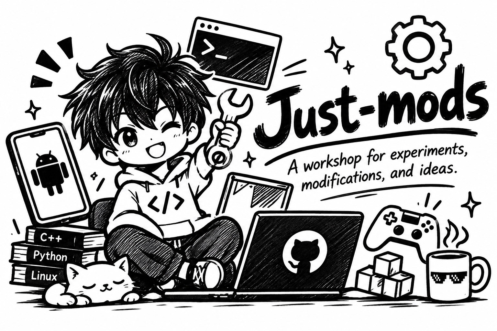

Just-mods

  

  <strong>A workshop for experiments, modifications, and ideas.</strong>
   
  Build it. Modify it. Explore it.

---

What is Just-mods?

Just-mods is a collection of personal projects, software modifications, experiments, and automated workflows.

From Android applications and native graphics projects to AI tooling and game modifications, this repository is where ideas get built, tested, and shared.

Projects

AI Edge Gallery · ARM32 Edition

An Android 10 and 32-bit ARM adaptation of AI Edge Gallery, with extended tooling and native LiteRT-LM integration.

"Explore the project" (prebuilt/armeabi-v7a/README.md)

ScreenFX

An Android screen-effects application featuring image adjustments, presets, saved looks, and an overlay service.

AgX Punchy · GTA San Andreas

An automated build workflow for packaging a custom AgX grading shader with the SAShaderL native library for ARM32.

ToonSky

A native graphics project exploring OpenGL ES, toon shading, sky effects, and post-processing.

HI3 5.4 Analysis

An automated APK inspection workflow that examines package contents, native libraries, resources, and other technical details.

What's inside?

- Android applications and modifications
- Native C/C++ and OpenGL projects
- AI and on-device experimentation
- Shader and graphics experiments
- GitHub Actions build and release workflows
- APK inspection and analysis automation

Built around experimentation

This repository isn't tied to one framework or one kind of project. Each experiment has its own purpose, implementation, and workflow.

Some projects are applications, some are native modifications, and others are automated tools that make development easier.

Support

If you find something useful here and would like to support further experiments:

  <a href="https://buymeacoffee.com/abhi13.coder">
    <strong>☕ Buy me a coffee</strong>
  </a>

---

  <strong>Just-mods</strong> · Made to experiment. Built to share.
   
  by Abhi

